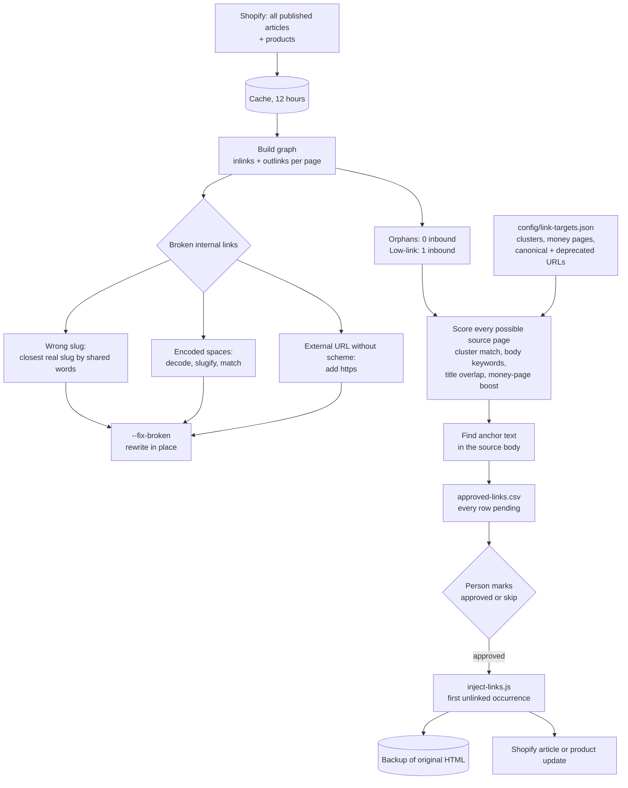

# Internal Link Graph: find the pages nothing links to, suggest the links, and inject the approved ones

Two scripts for a Shopify blog. The first reads every published post and product, builds the full internal link graph, finds orphan pages and broken internal links, and writes a CSV of suggested links with anchor text. The second injects the rows a person approved, with a backup of every page it changes.

## The problem

A blog that publishes daily builds up posts that no other page links to. Search engines find them late and rank them poorly, and readers never reach them. With a few hundred posts, nobody can hold the link structure in their head, and the store's product pages, the ones that earn money, end up with fewer internal links than old blog posts.

AI-written content added a second problem: links to pages that do not exist. A model asked to add internal links will sometimes produce a slug that looks right and is not real, or paste an external domain without its scheme so it resolves as a path under the blog.

## What it does

| Script | What happens |
|---|---|
| `src/link-graph.js` | Fetches all published articles and products. Parses each body for internal links and builds a graph of inbound and outbound links per page. Reports orphans (no inbound links) and low-link pages (one). Detects broken internal links and classifies them. For each under-linked page, finds source posts that are on topic, do not already link to it, and contain usable anchor text. Writes the report, the suggestion CSV and the broken-link list, and emails a summary |
| `src/link-graph.js --fix-broken` | Rewrites broken links that have a confident fix. Preview with `--dry-run` |
| `src/inject-links.js` | Reads the CSV, and for each row marked `approved` wraps the anchor text in a link in the source page, saves the original HTML to a backup, and marks the row done |

## Architecture



## Key design decisions

**Suggest, then inject, with a person in between.** Every suggestion is written as `pending`. Nothing is injected until a row is changed to `approved`. The anchor finder is simple: it picks the longest word from the target's title that appears in the best-matching sentence, so some anchors are a single generic word. Review is where those get skipped. An `--auto-approve` flag exists for high-confidence rows and is off by default.

**Relevance is scored, not guessed.** A source page earns points for sharing the target's topic cluster, for containing the target's keywords in its body, and for title overlap. A suggestion needs a minimum score, and the best five sources per target are kept.

**Product pages are the preferred targets.** Pages listed as money pages in the config get a boost sized by their priority when the source post mentions their keywords, so a product that matches the topic outranks another blog post as a link target. Other product pages get a smaller fixed boost.

**Some pages are never targets.** URLs listed as deprecated, typically posts being redirected or noindexed, are excluded, so the tool does not build links into pages that are going away. Canonical URLs for a topic get a small boost for the opposite reason.

**Broken links are classified before they are fixed.** A slug that does not exist is matched to the closest real slug by shared words, and only when at least two words match. Encoded spaces are decoded and slugified. An external domain saved as a relative path gets its scheme back. Anything else is listed for manual review and left alone.

**Injection is conservative.** A link is not added if the source already links to the target. Existing links are split out of the HTML first, so anchor text inside another link is never touched, and only the first unlinked occurrence is wrapped, keeping the original casing.

**Every write has a backup.** The original body of each changed article or product is saved before the update, keyed by ID.

**The graph is cached.** Article bodies are reused for 12 hours, so the report and the fix modes can be rerun without refetching the whole blog.

## Repository layout

```
src/link-graph.js                  graph, orphans, broken links, suggestions, report, email
src/inject-links.js                CSV-driven link injection with backup
config/link-targets.example.json   topic clusters, money pages, canonical and deprecated URLs
scripts/test-graph.js              offline tests for the graph, suggestions and injection
.github/workflows/                 weekly analysis run, outputs uploaded as a run artifact
```

## Setup

Requires Node 20+ and a Shopify Admin API token with content read/write and product read access.

```bash
npm install
npm test                                                     # offline, no store needed
cp .env.example .env                                         # fill in values
cp config/link-targets.example.json config/link-targets.json # your clusters and target pages
npm run graph                                                # analysis, report and CSV in ./output
node src/link-graph.js --fix-broken --dry-run                # preview broken-link fixes
# review output/approved-links.csv, set status to approved or skip
node src/inject-links.js --dry-run
npm run inject
```

| Variable | Purpose |
|---|---|
| `SHOPIFY_STORE`, `SHOPIFY_ADMIN_TOKEN` | Articles and products |
| `SITE_URL` | Public site URL, used to recognize internal links |
| `SHOPIFY_BLOG_HANDLE`, `SHOPIFY_BLOG_ID` | The blog to analyze. The ID is looked up from the handle when empty; the injector needs it set |
| `GMAIL_USER`, `GMAIL_APP_PASSWORD`, `EMAIL_NOTIFY` | Optional summary email |
| `COMPANY_NAME`, `OUTPUT_DIR`, `CONFIG_DIR` | Optional overrides |

Scheduled runs are off by default. Set the repository variable `ENABLE_SCHEDULE` to `true` to turn the schedule on; manual runs from the Actions tab always work.

---

Extracted from a production automation suite I built and ran for a live e-commerce and B2B wholesale business, 2026.

© Michael Wootan. Source shared for portfolio review; all rights reserved.
